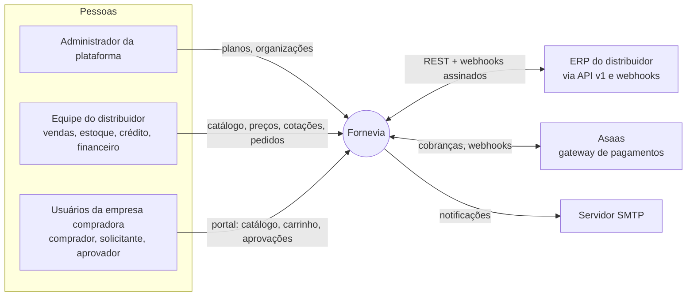
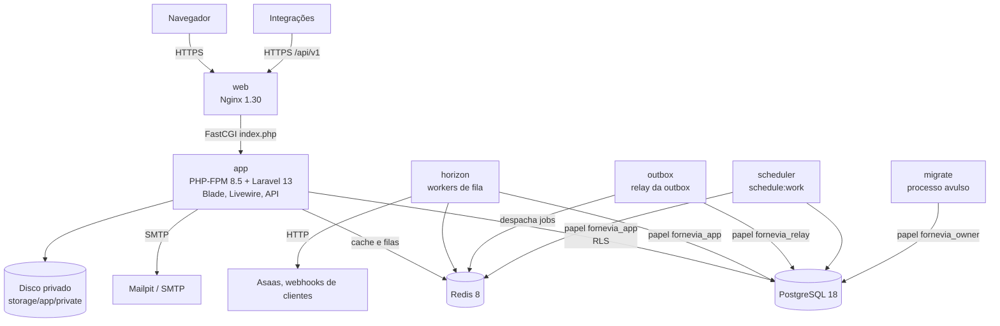
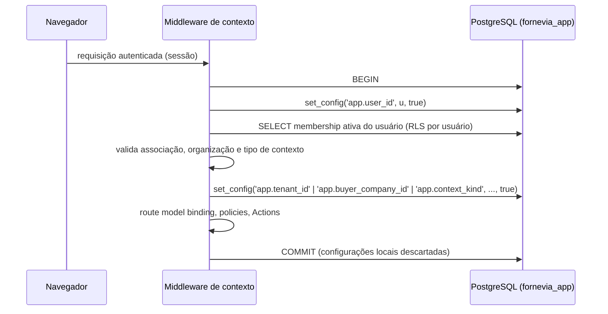
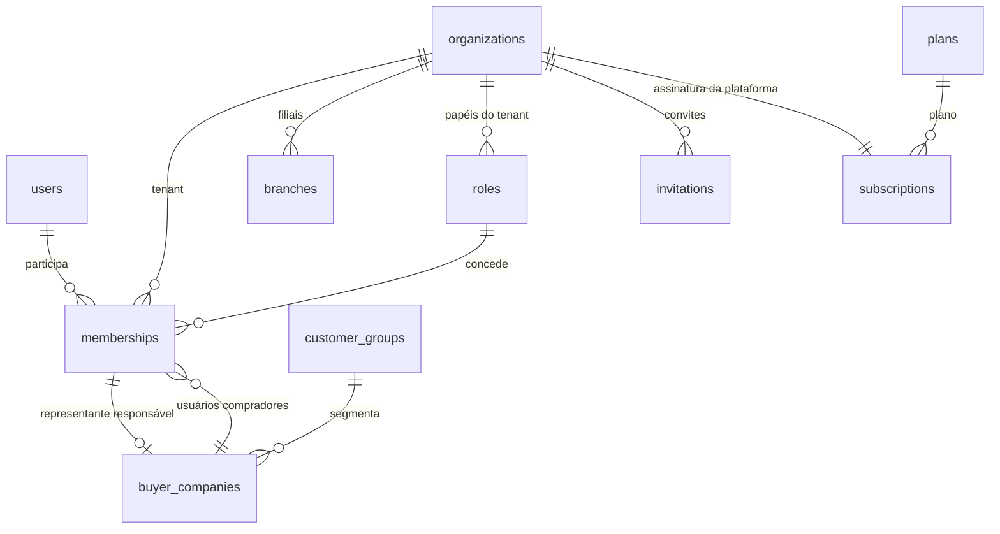
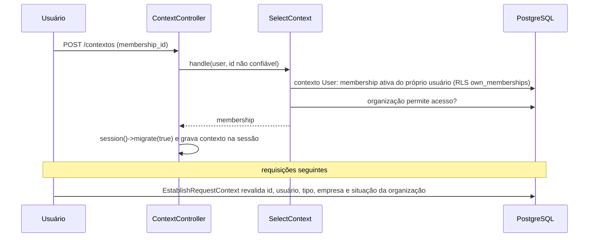
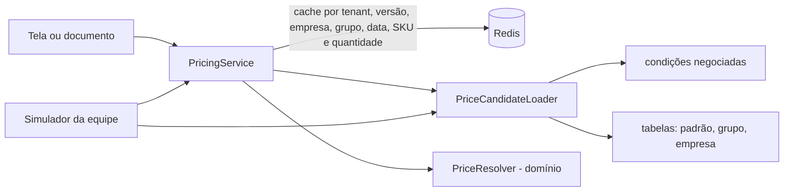
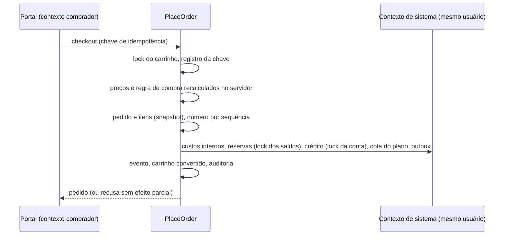
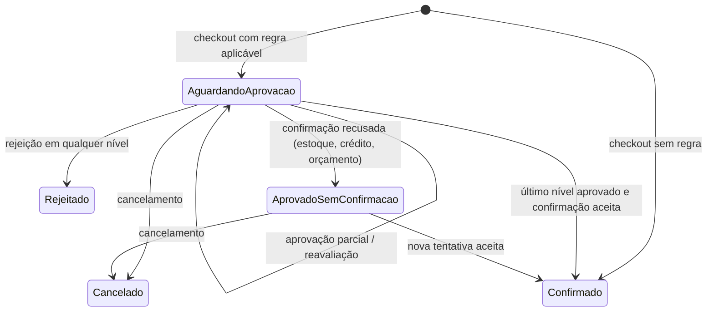

# Arquitetura

Visão técnica do Fornevia. Decisões e alternativas estão em
[DECISOES.md](DECISOES.md); requisitos em [REQUISITOS.md](REQUISITOS.md).

## 1. Contexto (C4 nível 1)

## 2. Containers (C4 nível 2)

| Container | Processo | Papel no banco |
|---|---|---|
| `web` | Nginx: arquivos estáticos e encaminhamento de `index.php` | — |
| `app` | PHP-FPM: interface Blade/Livewire e API v1 | `fornevia_app` |
| `horizon` | Workers Redis supervisionados | `fornevia_app` |
| `outbox` | `php artisan outbox:relay` | `fornevia_relay` |
| `scheduler` | `php artisan schedule:work` | `fornevia_app` |
| `migrate` | `php artisan migrate --force` (avulso) | `fornevia_owner` |

Migrations nunca rodam na inicialização de `app`, `horizon`, `scheduler`
ou `outbox`. O readiness (`/health/ready`) falha enquanto houver migration
pendente.

## 3. Organização do código

| Camada | Local | Responsabilidade |
|---|---|---|
| Domínio | `app/Domain/<Contexto>` | Regras puras e value objects (Money, Quantity, PriceResolver). Sem Laravel; testadas sem banco |
| Casos de uso | `app/Actions/<Contexto>` | Orquestram transação, locks, validações de negócio, ledger e outbox |
| Persistência | `app/Models/<Contexto>` | Eloquent com `BelongsToTenant`; sem regras de negócio extensas |
| Autorização | `app/Policies/<Contexto>` + Gates | Permissão do contexto e propriedade do objeto |
| HTTP | `app/Http` | Controllers finos, Form Requests, Resources da API v1 |
| Interface | `app/Livewire`, `resources/views` | Componentes que chamam Actions e Policies |
| Assíncrono | `app/Jobs` | Jobs idempotentes com identificadores (sem models serializados) |
| Integrações | `app/Integrations` | Adaptadores (pagamentos, webhooks) |
| Infraestrutura | `app/Support` | Tenancy, idempotência, outbox, observabilidade, HTTP |

## 4. Estratégia de multitenancy

- `CurrentContext` é *scoped*: descartado ao fim de cada requisição e antes
  de cada job pelo worker.
- `TenantDatabase::run()` é o único caminho para aplicar contexto. Aninhar
  o mesmo contexto reaproveita a transação; aninhar contexto diferente lança
  `TenantContextConflict`.
- Políticas de RLS: `tenant_isolation` (permissiva) em toda tabela com
  `tenant_id`; `buyer_isolation` (restritiva) em tabelas de comprador, que
  só exibem linhas da empresa do contexto quando o tipo é `buyer`.
- Funções: `app_current_tenant()`, `app_current_buyer()`,
  `app_current_user()`, `app_context_kind()`, `app_sees_all_buyers()`.

## 5. Papéis do banco

| Papel | Uso | Privilégios |
|---|---|---|
| `fornevia_owner` | migrations, manutenção | dono do schema; sujeito à RLS forçada |
| `fornevia_app` | aplicação, workers, scheduler | DML via default privileges; sem `UPDATE`/`DELETE` em ledgers; sem escrita em colunas de saldo |
| `fornevia_relay` | relay da outbox | apenas tabelas da outbox |

Provisionamento: `docker/postgres/init/01-roles.sh` (superusuário, uma vez
por cluster). Senhas por variáveis de ambiente.

## 6. Filas

| Fila | Supervisor Horizon | Uso |
|---|---|---|
| `critical` | `operacao` | eventos da outbox que afetam operação |
| `default` | `operacao` | processamento geral |
| `notifications` | `operacao` | e-mails e notificações |
| `integrations` | `integracoes` | provedores externos e webhooks enviados |

Timeouts dos supervisores (90 s e 120 s) ficam abaixo do `retry_after` da
conexão Redis (330 s). Jobs despachados dentro de transação só são
publicados após o commit (`after_commit`). O painel do Horizon exige
autenticação, e-mail verificado e 2FA confirmado, em qualquer ambiente, para
administradores da plataforma ou e-mails em `HORIZON_ALLOWED_EMAILS`.

## 6.1 Observabilidade

- Logs JSON em stderr (`LOG_STACK=json`), com `correlation_id`,
  `tenant_id`, `user_id` e `context_kind` vindos do `Context` do Laravel,
  propagados para jobs. Campos sensíveis são redigidos
  (`RedactSensitiveData`).
- `X-Request-Id` aceito em formato restrito ou gerado (UUIDv7).
- `/health/live` e `/health/ready` sem sessão nem cookies.

## 7. Identidade, contextos e permissões

### 7.1 Modelo

- **Usuário** (`users`) é identidade global, sem permissões próprias.
- **Associação** (`memberships`) liga o usuário a um contexto: equipe do
  distribuidor (`staff`) ou usuário de uma empresa compradora (`buyer`). Um
  mesmo usuário pode ser equipe no distribuidor A e comprador no B.
- **Papel** (`roles`) é do tenant, com lista de permissões e limite de
  desconto. Onze papéis padrão são criados no onboarding.
- **Convite** guarda apenas o hash SHA-256 do token; vale 7 dias; reenvio
  revoga o pendente anterior.
- Revogação mantém o registro (status `revoked`, autor, data e motivo).

### 7.2 Seleção de contexto e validação por requisição

A elevação temporária para outro contexto do **mesmo usuário** ocorre em
savepoint (seleção de contexto, aceite de convite, onboarding); o contexto
anterior é reaplicado ao final. Trocas para contextos sem usuário ou de
outro usuário lançam `TenantContextConflict` (ADR-014).

### 7.2.1 Proteções da sessão e da autenticação

- Sessões de outros dispositivos deixam de valer quando a senha muda
  (`AuthenticateSession`); a redefinição de senha apaga todas as sessões
  persistidas do usuário.
- Links enviados por e-mail usam `APP_URL` (`URL::forceRootUrl`), e apenas o
  host configurado é aceito fora de ambiente local (proteção contra
  envenenamento do cabeçalho Host).
- A página de segurança exige confirmação recente de senha, responde com
  `Cache-Control: no-store` e fica acessível com e-mail ainda não
  verificado (para corrigir endereço digitado errado).
- Desafio 2FA limitado por conta (5/min) e por IP (20/min).
- Middlewares de bloqueio interrompem o pipeline por exceção ou redirect;
  autenticação, e-mail verificado, contexto, permissão e 2FA são
  reaplicados nas ações Livewire (middleware persistente).
- Identificadores recebidos em ações Livewire fora do formato UUID são
  tratados como registro inexistente (`UntrustedId`).

### 7.3 Matriz de permissões (papéis padrão)

Gerada a partir de `App\Enums\Identity\SystemRole`. Permissões marcadas com
(2FA) exigem autenticação em dois fatores confirmada para acessar o contexto.

| Permissão | Proprietário | Administrador | Gerente comercial | Representante comercial | Estoque e expedição | Financeiro e crédito | Consulta |
|---|---|---|---|---|---|---|---|
| `organization.manage` Gerenciar organização e filiais (2FA) | ✓ | ✓ |  |  |  |  |  |
| `members.manage` Gerenciar equipe e convites (2FA) | ✓ | ✓ |  |  |  |  |  |
| `buyers.view` Ver empresas compradoras | ✓ | ✓ | ✓ | ✓ |  | ✓ | ✓ |
| `buyers.manage` Gerenciar empresas compradoras | ✓ | ✓ | ✓ |  |  |  |  |
| `catalog.view` Ver catálogo | ✓ | ✓ | ✓ | ✓ | ✓ |  | ✓ |
| `catalog.manage` Gerenciar catálogo | ✓ | ✓ |  |  |  |  |  |
| `catalog.view_costs` Ver custos e margens | ✓ | ✓ | ✓ |  |  |  |  |
| `pricing.view` Ver tabelas de preço | ✓ | ✓ | ✓ | ✓ |  |  | ✓ |
| `pricing.manage` Gerenciar tabelas de preço | ✓ | ✓ | ✓ |  |  |  |  |
| `pricing.approve` Aprovar descontos e exceções de preço | ✓ | ✓ | ✓ |  |  |  |  |
| `quotes.view` Ver cotações | ✓ | ✓ | ✓ | ✓ |  |  | ✓ |
| `quotes.manage` Elaborar propostas | ✓ | ✓ | ✓ | ✓ |  |  |  |
| `orders.view` Ver pedidos | ✓ | ✓ | ✓ | ✓ | ✓ | ✓ | ✓ |
| `orders.manage` Gerenciar pedidos | ✓ | ✓ | ✓ |  |  |  |  |
| `inventory.view` Ver estoque | ✓ | ✓ | ✓ | ✓ | ✓ |  | ✓ |
| `inventory.manage` Movimentar estoque | ✓ | ✓ |  |  | ✓ |  |  |
| `credit.view` Ver crédito comercial | ✓ | ✓ | ✓ | ✓ |  | ✓ | ✓ |
| `credit.manage` Gerenciar limites e exceções de crédito (2FA) | ✓ | ✓ |  |  |  | ✓ |  |
| `fulfillment.view` Ver expedição | ✓ | ✓ | ✓ |  | ✓ |  | ✓ |
| `fulfillment.manage` Operar separação e expedição | ✓ | ✓ |  |  | ✓ |  |  |
| `returns.view` Ver devoluções | ✓ | ✓ | ✓ |  | ✓ | ✓ | ✓ |
| `returns.manage` Operar devoluções | ✓ | ✓ |  |  | ✓ |  |  |
| `finance.view` Ver financeiro | ✓ | ✓ |  |  |  | ✓ | ✓ |
| `finance.manage` Operar financeiro (2FA) | ✓ | ✓ |  |  |  | ✓ |  |
| `integrations.manage` Gerenciar integrações (2FA) | ✓ | ✓ |  |  |  |  |  |
| `audit.view` Ver auditoria | ✓ | ✓ | ✓ |  |  | ✓ |  |
| `reports.view` Ver indicadores | ✓ | ✓ | ✓ |  |  | ✓ | ✓ |
| `subscription.manage` Gerenciar assinatura do Fornevia (2FA) | ✓ |  |  |  |  |  |  |
| Limite de desconto | 100% | 100% | 15% | 5% | 0% | 0% | 0% |

| Permissão | Administrador da empresa | Comprador | Solicitante | Aprovador |
|---|---|---|---|---|
| `portal.catalog` Ver catálogo e preços | ✓ | ✓ | ✓ | ✓ |
| `portal.cart` Montar carrinho e listas | ✓ | ✓ | ✓ |  |
| `portal.orders.place` Confirmar pedidos | ✓ | ✓ |  |  |
| `portal.orders.view_all` Ver todos os pedidos da empresa | ✓ | ✓ |  | ✓ |
| `portal.quotes` Solicitar cotações | ✓ | ✓ | ✓ |  |
| `portal.approvals` Aprovar compras | ✓ |  |  | ✓ |
| `portal.budgets` Gerenciar orçamentos | ✓ |  |  |  |
| `portal.approval_rules` Gerenciar regras e delegações de aprovação | ✓ |  |  |  |
| `portal.users` Gerenciar usuários da empresa | ✓ |  |  |  |

Regras adicionais:

- Permissões `portal.*` só têm efeito em contexto de comprador; as demais,
  em contexto de equipe (`Access::can`).
- Somente proprietários concedem, retiram ou revogam o papel de proprietário;
  a organização mantém ao menos um proprietário ativo (`OwnershipGuard`).
- Usuários de comprador com `portal.users` gerenciam apenas a própria empresa.
- Ocultar itens de navegação não é controle de acesso: rotas, middleware
  persistente do Livewire e Actions validam no servidor.

### 7.4 Limites do plano

| Recurso | Verificação |
|---|---|
| Usuários da equipe | ativos + convites pendentes, com a assinatura bloqueada (`FOR UPDATE`) |
| Filiais | contagem com a assinatura bloqueada |
| Pedidos por mês | incremento condicional em `tenant_usage_counters` na transação da confirmação |
| Módulos | incluídos no plano ou contratados como adicionais ativos |
| Trial expirado ou assinatura cancelada | operações de escrita recusadas (`SubscriptionInactive`) |

## 8. Compradores, catálogo e preços

### 8.1 Empresas compradoras

Cadastro com CNPJ validado, grupo de clientes, representante responsável,
unidades, endereços (um padrão por finalidade), centros de custo, contatos,
condições de pagamento permitidas (com uma padrão) e histórico montado a
partir da auditoria do tenant. As tabelas de detalhes usam RLS `required`
(o comprador lê apenas a própria empresa) e são somente leitura no contexto
de comprador (o cadastro é mantido pela equipe).

O histórico filtra a auditoria pelo assunto (empresa, associações e
convites) e pela coluna gerada `audit_logs.buyer_company_id` (extraída de
`data->>'buyer_company_id'` quando é UUID), indexada. Uma expressão sobre
`jsonb` não seria usada como índice sob RLS (operador não *leakproof*);
a comparação `uuid = uuid` é. Condições negociadas só aparecem para quem
tem `pricing.view`.

No banco, o comprador não lê a auditoria do tenant e só grava registros em
nome do próprio usuário, sem atribuí-los a outra empresa.

### 8.2 Catálogo

| Conceito | Regra |
|---|---|
| Unidade de medida | código único, 0 a 3 casas decimais; reduzir casas é recusado se algum SKU vendido na unidade, ou de produto que a usa como unidade base, deixaria de ter mínimo, múltiplo, faixa de preço ou quantidade convertida representáveis |
| Produto | unidade base fixa depois que existe SKU; situação (rascunho, ativo, inativo, arquivado); visibilidade pública ou restrita |
| SKU | unidade de venda, fator de conversão (`numeric(18,6)`), mínimo e múltiplo nas casas da unidade de venda; mínimo × fator e múltiplo × fator exatos na unidade base (RN-021) |
| Embalagem com preço | SKU com item de tabela ou condição negociada ativa não troca unidade de venda nem fator: os preços estão na unidade de venda; nova embalagem é um novo SKU. Formulários de preço guardam a embalagem vista ao abrir e recusam a gravação se ela mudou |
| Limites de quantidade | mínimo, múltiplo e quantidade por linha até 999.999.999; quantidades convertidas para a unidade base dentro de `numeric(18,3)` |
| Custos e política comercial | `sku_costs` (histórico imutável) e `sku_commercial_policies` com política `internal_only`: invisíveis ao comprador no banco; exibição exige `catalog.view_costs` |
| Mídias | disco privado, tipo verificado pelo conteúdo, download por rota autorizada; o envio temporário do Livewire só é aceito para quem tem `catalog.manage` |

Visibilidade para o comprador, verificada no banco
(`app_buyer_sees_product`): produto ativo e público, ou restrito em
catálogo privado ativo atribuído à empresa ou ao grupo dela. Os próprios
catálogos privados, seus produtos e atribuições seguem o mesmo critério:
o comprador não descobre catálogos de outros grupos.

Inclusão e remoção de produtos de catálogo privado pela tela são
incrementais e calculadas sob o lock do catálogo, sem desfazer alterações
concorrentes.

### 8.3 Preços

- Precedência e faixas: ADR-010 e ADR-011, implementadas no domínio puro
  (`PriceResolver`).
- `PriceCandidateLoader` é a única consulta de candidatos, usada pelo
  cálculo e pelo simulador (que explica a ordem aplicando o próprio
  resolvedor sucessivamente).
- Invalidação: `pricing_settings.price_version` é incrementada na mesma
  transação de qualquer alteração que afete preço (itens, faixas,
  ativação, arquivamento, condições negociadas, grupo da empresa,
  política comercial do SKU); a versão faz parte da chave do cache.
- O cache não passa pelo RLS: no contexto de comprador, o serviço recusa
  calcular para outra empresa (evita ler ou gravar entradas de terceiros).
- `pricing_settings` (versão de preços) é legível pelo comprador e somente
  leitura nesse contexto; a margem mínima padrão fica em `pricing_policies`,
  invisível ao comprador no banco (`internal_only`) e enviada ao navegador
  apenas de quem tem `pricing.manage`.
- Itens, faixas e condições negociadas herdam também a visibilidade do SKU:
  o comprador não vê preço de produto restrito fora do seu catálogo.
- Faixas aceitam quantidade mínima apenas com as casas decimais da unidade
  de venda.

### 8.4 Entrada numérica e limites

| Entrada | Interpretação |
|---|---|
| Valores em reais | `1.234,56`, `1234,56` ou `1234.56`; até 2 casas |
| Quantidades nas telas de preço e no portal | pt-BR: `1.000` = mil, `1.250,5`, `2,5`; ponto seguido de 1 ou 2 dígitos, ou após zero inicial, é decimal (`2.5`, `0.500`) |
| Quantidades e fatores no cadastro de SKU | apenas vírgula decimal (`0,5`); ponto recusado para evitar ambiguidade |
| Limites | dinheiro até R$ 10 trilhões em centavos; quantidades até 15 dígitos inteiros (`numeric(18,3)`) |

Valores fora do intervalo geram `AmountOutOfRange` (regra de negócio,
código `amount_out_of_range`), exibida no campo, nunca como erro 500. No
portal, um total que excederia o limite não é calculado: a tela pede
redução da quantidade.
Datas comerciais digitadas aceitam de 2000-01-01 a 2099-12-31.

## 9. Estoque, crédito e pedidos

### 9.1 Ledgers e projeções (ADR-005)

| Ledger (append-only) | Projeção (por trigger) | Invariantes no banco |
|---|---|---|
| `stock_movements` (entrada, ajuste, transferência, reserva, liberação, saída) | `stock_levels` (físico, reservado por depósito e SKU) | sinais por tipo; físico ≥ 0; reservado ≤ físico |
| `credit_movements` (comprometimento, liberação, faturamento, pagamento, nota de crédito, ajuste) | `credit_accounts` (comprometido, recebível) | sinais por tipo; saldos ≥ 0; conta e empresa coerentes |

A aplicação não altera saldos diretamente: o papel `fornevia_app` não tem
`INSERT` nos saldos nem `UPDATE` nas colunas de saldo. O trigger de estoque
atualiza a linha existente antes de inserir: em `INSERT ... ON CONFLICT` o
PostgreSQL avalia o `CHECK` sobre a linha proposta antes do conflito.

Posição de crédito (RN-080): `exposição = comprometido + recebível`;
`disponível = limite + exceções vigentes − exposição`. Bloqueio e títulos
vencidos acima da tolerância recusam compra a prazo.

### 9.2 Confirmação do pedido (RN-060)

Ordem de locks (ADR-006): carrinho → chave de idempotência → saldos de
estoque (depósito, SKU) → conta de crédito → contador do plano. Gravações
em estoque, crédito, custos, contador e outbox usam o contexto de sistema do
mesmo usuário (ADR-014), porque o contexto de comprador só lê essas tabelas.

Cancelamento (RF-062): itens não expedidos, liberando primeiro a parte
encomendada, depois reservas, e o crédito proporcional (o restante inteiro
no cancelamento total).

### 9.3 Garantias verificadas com processos concorrentes

| Cenário | Resultado esperado |
|---|---|
| Duas compras pela última unidade | uma confirma; a outra recebe `InsufficientStock` |
| Quatro compras disputando saldo parcial | reservado = soma das reservas ativas; sem negativo |
| Duas compras no mesmo limite de crédito | apenas o que cabe no disponível é comprometido |
| Envios simultâneos com a mesma chave | um único pedido; o segundo recebe o mesmo resultado |

### 9.4 Telas e permissões

| Área | Rotas | Permissões |
|---|---|---|
| Portal: carrinho, pedido rápido, listas, recompra, checkout | `portal.cart`, `portal.quick-order`, `portal.lists`, `portal.lists.show` | `portal.cart`; confirmação exige `portal.orders.place` |
| Portal: meus pedidos | `portal.orders`, `portal.orders.show`, `portal.orders.confirmation` | próprios pedidos; com `portal.orders.view_all`, os da empresa |
| Equipe: pedidos | `orders.index`, `orders.show` | `orders.view`; cancelamento com `orders.manage`; custo e margem com `catalog.view_costs` |
| Equipe: estoque | `inventory.index`, `inventory.movements`, `inventory.warehouses`, `inventory.operations` | `inventory.view`; operações com `inventory.manage` |
| Equipe: crédito | `credit.index`, `credit.show` | `credit.view`; alterações com `credit.manage` |
| Portal: aprovações | `portal.approvals`, `portal.approvals.show` | `portal.approvals` (aprovador do nível, delegado vigente ou quem já decidiu); bloqueados e reatribuição com `portal.approval_rules` |
| Portal: regras e delegações | `portal.approval-rules`, `portal.approval-rules.create`, `portal.approval-rules.edit`, `portal.delegations` | regras com `portal.approval_rules`; delegações com `portal.approval_rules` (todas) ou `portal.approvals` (as próprias) |
| Portal: orçamentos | `portal.budgets`, `portal.budgets.show` | `portal.budgets` |

- O representante comercial (papel `sales_rep`) consulta apenas pedidos das
  empresas da própria carteira (`buyer_companies.sales_rep_membership_id`),
  regra aplicada na consulta de pedidos da equipe. Cadastro de empresas,
  crédito e estoque seguem as permissões do papel, sem recorte de carteira.
- O checkout exibe o total calculado no servidor e o envia como valor
  esperado: se preços mudarem até a confirmação, ela é recusada
  (`PricesChanged`). A chave de idempotência é gerada no servidor a cada
  tentativa.
- Números de pedido são sequenciais por distribuidor (`PED-0000001`),
  atribuídos no fim da confirmação (ADR-022).
- Reservas, movimentações de estoque e dados de crédito não são legíveis no
  contexto de comprador, nem os da própria empresa (ADR-020).

## 10. Aprovação de compras e orçamento

| Etapa | Orçamento | Estoque e crédito |
|---|---|---|
| Submissão para aprovação | reserva do total | não reservados |
| Rejeição ou cancelamento | liberação da reserva | — |
| Reavaliação (novo total) | liberação e nova reserva | — |
| Confirmação | consumo (reserva convertida; diferença precisa caber) | reservados e comprometidos |
| Checkout sem aprovação | consumo direto | reservados e comprometidos |
| Cancelamento após a confirmação | estorno do consumo, proporcional | liberados, proporcionais |

- Regra aplicável, níveis, quórum, delegação, perda de acesso e
  reavaliação: ADR-023.
- A decisão bloqueia o pedido antes de ler níveis e decisões: aprovações
  simultâneas que completam o quórum geram uma única confirmação, e a
  aprovação final que concorre com o cancelamento encontra o pedido
  cancelado (verificado com processos concorrentes, esperando o lock da
  linha do pedido); submissões simultâneas não ultrapassam o orçamento
  (bloqueio do orçamento antes da reserva).
- Tabelas da aprovação usam RLS `required` (a empresa compradora vê apenas
  as suas) e chaves estrangeiras compostas que incluem a empresa. Regras,
  delegações e valores de orçamento são administrados pela empresa; pedidos,
  níveis, decisões e movimentos de orçamento são somente leitura no
  contexto de comprador e gravados no contexto de sistema do mesmo usuário
  (ADR-024). Decisões são append-only, com invalidação definitiva em
  coluna própria; o nível retratado não muda de quórum e situações
  encerradas não voltam (triggers).

