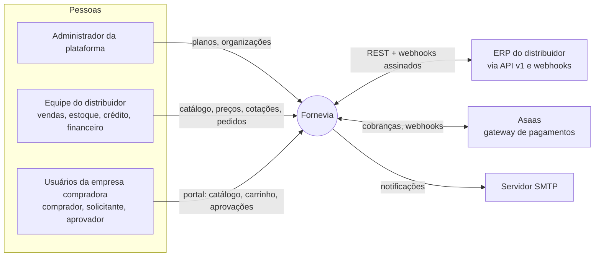
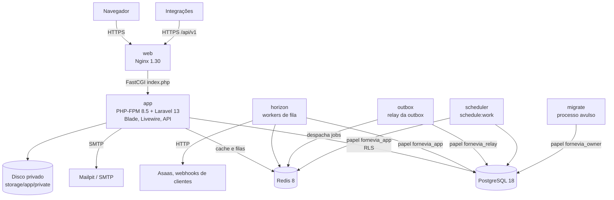
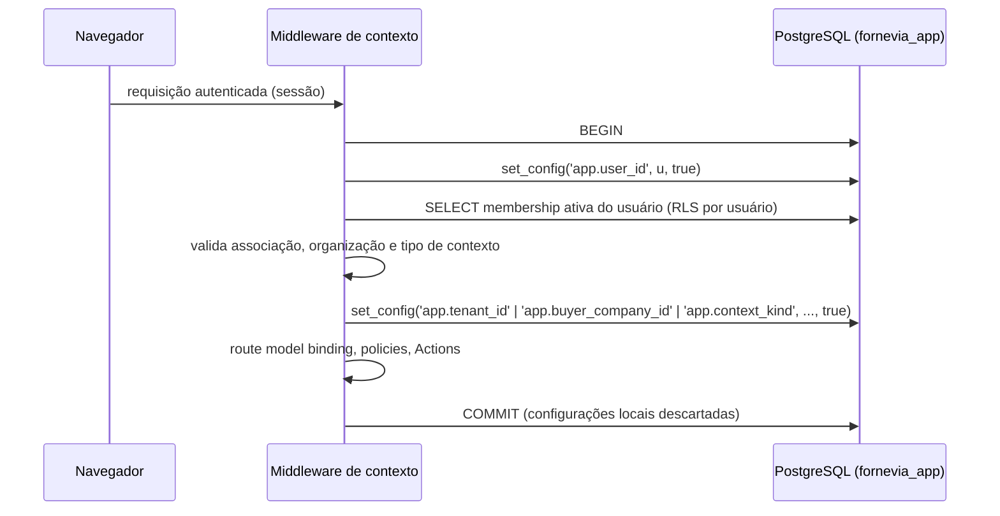
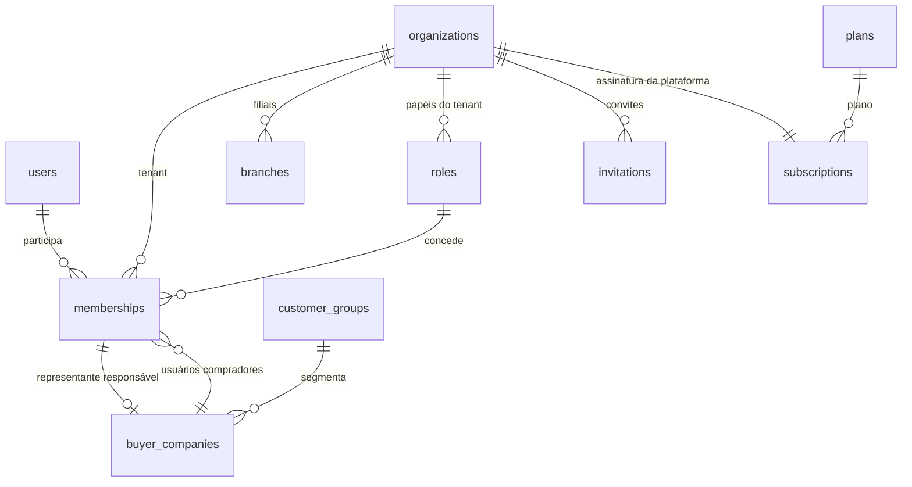
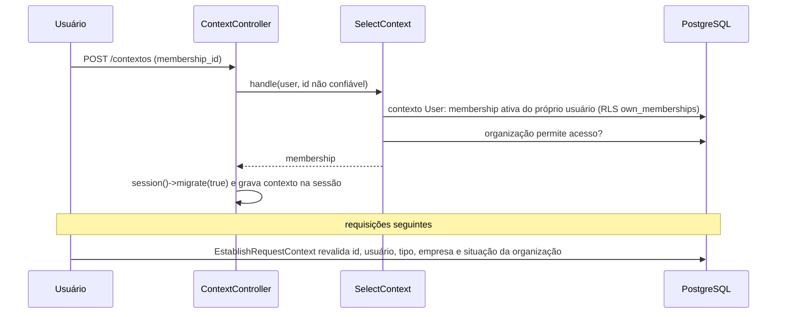

# Arquitetura

Visão técnica do Fornevia. Decisões e alternativas estão em
[DECISOES.md](DECISOES.md); requisitos em [REQUISITOS.md](REQUISITOS.md).

## 1. Contexto (C4 nível 1)

## 2. Containers (C4 nível 2)

| Container | Processo | Papel no banco |
|---|---|---|
| `web` | Nginx: arquivos estáticos e encaminhamento de `index.php` | — |
| `app` | PHP-FPM: interface Blade/Livewire e API v1 | `fornevia_app` |
| `horizon` | Workers Redis supervisionados | `fornevia_app` |
| `outbox` | `php artisan outbox:relay` | `fornevia_relay` |
| `scheduler` | `php artisan schedule:work` | `fornevia_app` |
| `migrate` | `php artisan migrate --force` (avulso) | `fornevia_owner` |

Migrations nunca rodam na inicialização de `app`, `horizon`, `scheduler`
ou `outbox`. O readiness (`/health/ready`) falha enquanto houver migration
pendente.

## 3. Organização do código

| Camada | Local | Responsabilidade |
|---|---|---|
| Domínio | `app/Domain/<Contexto>` | Regras puras e value objects (Money, Quantity, PriceResolver). Sem Laravel; testadas sem banco |
| Casos de uso | `app/Actions/<Contexto>` | Orquestram transação, locks, validações de negócio, ledger e outbox |
| Persistência | `app/Models/<Contexto>` | Eloquent com `BelongsToTenant`; sem regras de negócio extensas |
| Autorização | `app/Policies/<Contexto>` + Gates | Permissão do contexto e propriedade do objeto |
| HTTP | `app/Http` | Controllers finos, Form Requests, Resources da API v1 |
| Interface | `app/Livewire`, `resources/views` | Componentes que chamam Actions e Policies |
| Assíncrono | `app/Jobs` | Jobs idempotentes com identificadores (sem models serializados) |
| Integrações | `app/Integrations` | Adaptadores (pagamentos, webhooks) |
| Infraestrutura | `app/Support` | Tenancy, idempotência, outbox, observabilidade, HTTP |

## 4. Estratégia de multitenancy

- `CurrentContext` é *scoped*: descartado ao fim de cada requisição e antes
  de cada job pelo worker.
- `TenantDatabase::run()` é o único caminho para aplicar contexto. Aninhar
  o mesmo contexto reaproveita a transação; aninhar contexto diferente lança
  `TenantContextConflict`.
- Políticas de RLS: `tenant_isolation` (permissiva) em toda tabela com
  `tenant_id`; `buyer_isolation` (restritiva) em tabelas de comprador, que
  só exibem linhas da empresa do contexto quando o tipo é `buyer`.
- Funções: `app_current_tenant()`, `app_current_buyer()`,
  `app_current_user()`, `app_context_kind()`, `app_sees_all_buyers()`.

## 5. Papéis do banco

| Papel | Uso | Privilégios |
|---|---|---|
| `fornevia_owner` | migrations, manutenção | dono do schema; sujeito à RLS forçada |
| `fornevia_app` | aplicação, workers, scheduler | DML via default privileges; sem `UPDATE`/`DELETE` em ledgers; sem escrita em colunas de saldo |
| `fornevia_relay` | relay da outbox | apenas tabelas da outbox |

Provisionamento: `docker/postgres/init/01-roles.sh` (superusuário, uma vez
por cluster). Senhas por variáveis de ambiente.

## 6. Filas

| Fila | Supervisor Horizon | Uso |
|---|---|---|
| `critical` | `operacao` | eventos da outbox que afetam operação |
| `default` | `operacao` | processamento geral |
| `notifications` | `operacao` | e-mails e notificações |
| `integrations` | `integracoes` | provedores externos e webhooks enviados |

Timeouts dos supervisores (90 s e 120 s) ficam abaixo do `retry_after` da
conexão Redis (330 s). Jobs despachados dentro de transação só são
publicados após o commit (`after_commit`). O painel do Horizon exige
autenticação, e-mail verificado e 2FA confirmado, em qualquer ambiente, para
administradores da plataforma ou e-mails em `HORIZON_ALLOWED_EMAILS`.

## 6.1 Observabilidade

- Logs JSON em stderr (`LOG_STACK=json`), com `correlation_id`,
  `tenant_id`, `user_id` e `context_kind` vindos do `Context` do Laravel,
  propagados para jobs. Campos sensíveis são redigidos
  (`RedactSensitiveData`).
- `X-Request-Id` aceito em formato restrito ou gerado (UUIDv7).
- `/health/live` e `/health/ready` sem sessão nem cookies.

## 7. Identidade, contextos e permissões

### 7.1 Modelo

- **Usuário** (`users`) é identidade global, sem permissões próprias.
- **Associação** (`memberships`) liga o usuário a um contexto: equipe do
  distribuidor (`staff`) ou usuário de uma empresa compradora (`buyer`). Um
  mesmo usuário pode ser equipe no distribuidor A e comprador no B.
- **Papel** (`roles`) é do tenant, com lista de permissões e limite de
  desconto. Onze papéis padrão são criados no onboarding.
- **Convite** guarda apenas o hash SHA-256 do token; vale 7 dias; reenvio
  revoga o pendente anterior.
- Revogação mantém o registro (status `revoked`, autor, data e motivo).

### 7.2 Seleção de contexto e validação por requisição

A elevação temporária para outro contexto do **mesmo usuário** ocorre em
savepoint (seleção de contexto, aceite de convite, onboarding); o contexto
anterior é reaplicado ao final. Trocas para contextos sem usuário ou de
outro usuário lançam `TenantContextConflict` (ADR-014).

### 7.2.1 Proteções da sessão e da autenticação

- Sessões de outros dispositivos deixam de valer quando a senha muda
  (`AuthenticateSession`); a redefinição de senha apaga todas as sessões
  persistidas do usuário.
- Links enviados por e-mail usam `APP_URL` (`URL::forceRootUrl`), e apenas o
  host configurado é aceito fora de ambiente local (proteção contra
  envenenamento do cabeçalho Host).
- A página de segurança exige confirmação recente de senha, responde com
  `Cache-Control: no-store` e fica acessível com e-mail ainda não
  verificado (para corrigir endereço digitado errado).
- Desafio 2FA limitado por conta (5/min) e por IP (20/min).
- Middlewares de bloqueio interrompem o pipeline por exceção ou redirect;
  autenticação, e-mail verificado, contexto, permissão e 2FA são
  reaplicados nas ações Livewire (middleware persistente).
- Identificadores recebidos em ações Livewire fora do formato UUID são
  tratados como registro inexistente (`UntrustedId`).

### 7.3 Matriz de permissões (papéis padrão)

Gerada a partir de `App\Enums\Identity\SystemRole`. Permissões marcadas com
(2FA) exigem autenticação em dois fatores confirmada para acessar o contexto.

| Permissão | Proprietário | Administrador | Gerente comercial | Representante comercial | Estoque e expedição | Financeiro e crédito | Consulta |
|---|---|---|---|---|---|---|---|
| `organization.manage` Gerenciar organização e filiais (2FA) | ✓ | ✓ |  |  |  |  |  |
| `members.manage` Gerenciar equipe e convites (2FA) | ✓ | ✓ |  |  |  |  |  |
| `buyers.view` Ver empresas compradoras | ✓ | ✓ | ✓ | ✓ |  | ✓ | ✓ |
| `buyers.manage` Gerenciar empresas compradoras | ✓ | ✓ | ✓ |  |  |  |  |
| `catalog.view` Ver catálogo | ✓ | ✓ | ✓ | ✓ | ✓ |  | ✓ |
| `catalog.manage` Gerenciar catálogo | ✓ | ✓ |  |  |  |  |  |
| `catalog.view_costs` Ver custos e margens | ✓ | ✓ | ✓ |  |  |  |  |
| `pricing.view` Ver tabelas de preço | ✓ | ✓ | ✓ | ✓ |  |  | ✓ |
| `pricing.manage` Gerenciar tabelas de preço | ✓ | ✓ | ✓ |  |  |  |  |
| `pricing.approve` Aprovar descontos e exceções de preço | ✓ | ✓ | ✓ |  |  |  |  |
| `quotes.view` Ver cotações | ✓ | ✓ | ✓ | ✓ |  |  | ✓ |
| `quotes.manage` Elaborar propostas | ✓ | ✓ | ✓ | ✓ |  |  |  |
| `orders.view` Ver pedidos | ✓ | ✓ | ✓ | ✓ | ✓ | ✓ | ✓ |
| `orders.manage` Gerenciar pedidos | ✓ | ✓ | ✓ |  |  |  |  |
| `inventory.view` Ver estoque | ✓ | ✓ | ✓ | ✓ | ✓ |  | ✓ |
| `inventory.manage` Movimentar estoque | ✓ | ✓ |  |  | ✓ |  |  |
| `credit.view` Ver crédito comercial | ✓ | ✓ | ✓ | ✓ |  | ✓ | ✓ |
| `credit.manage` Gerenciar limites e exceções de crédito (2FA) | ✓ | ✓ |  |  |  | ✓ |  |
| `fulfillment.view` Ver expedição | ✓ | ✓ | ✓ |  | ✓ |  | ✓ |
| `fulfillment.manage` Operar separação e expedição | ✓ | ✓ |  |  | ✓ |  |  |
| `returns.view` Ver devoluções | ✓ | ✓ | ✓ |  | ✓ | ✓ | ✓ |
| `returns.manage` Operar devoluções | ✓ | ✓ |  |  | ✓ |  |  |
| `finance.view` Ver financeiro | ✓ | ✓ |  |  |  | ✓ | ✓ |
| `finance.manage` Operar financeiro (2FA) | ✓ | ✓ |  |  |  | ✓ |  |
| `integrations.manage` Gerenciar integrações (2FA) | ✓ | ✓ |  |  |  |  |  |
| `audit.view` Ver auditoria | ✓ | ✓ | ✓ |  |  | ✓ |  |
| `reports.view` Ver indicadores | ✓ | ✓ | ✓ |  |  | ✓ | ✓ |
| `subscription.manage` Gerenciar assinatura do Fornevia (2FA) | ✓ |  |  |  |  |  |  |
| Limite de desconto | 100% | 100% | 15% | 5% | 0% | 0% | 0% |

| Permissão | Administrador da empresa | Comprador | Solicitante | Aprovador |
|---|---|---|---|---|
| `portal.catalog` Ver catálogo e preços | ✓ | ✓ | ✓ | ✓ |
| `portal.cart` Montar carrinho e listas | ✓ | ✓ | ✓ |  |
| `portal.orders.place` Confirmar pedidos | ✓ | ✓ |  |  |
| `portal.orders.view_all` Ver todos os pedidos da empresa | ✓ | ✓ |  | ✓ |
| `portal.quotes` Solicitar cotações | ✓ | ✓ | ✓ |  |
| `portal.approvals` Aprovar compras | ✓ |  |  | ✓ |
| `portal.budgets` Gerenciar orçamentos | ✓ |  |  |  |
| `portal.users` Gerenciar usuários da empresa | ✓ |  |  |  |

Regras adicionais:

- Permissões `portal.*` só têm efeito em contexto de comprador; as demais,
  em contexto de equipe (`Access::can`).
- Somente proprietários concedem, retiram ou revogam o papel de proprietário;
  a organização mantém ao menos um proprietário ativo (`OwnershipGuard`).
- Usuários de comprador com `portal.users` gerenciam apenas a própria empresa.
- Ocultar itens de navegação não é controle de acesso: rotas, middleware
  persistente do Livewire e Actions validam no servidor.

### 7.4 Limites do plano

| Recurso | Verificação |
|---|---|
| Usuários da equipe | ativos + convites pendentes, com a assinatura bloqueada (`FOR UPDATE`) |
| Filiais | contagem com a assinatura bloqueada |
| Pedidos por mês | incremento condicional em `tenant_usage_counters` na transação da confirmação |
| Módulos | incluídos no plano ou contratados como adicionais ativos |
| Trial expirado ou assinatura cancelada | operações de escrita recusadas (`SubscriptionInactive`) |
