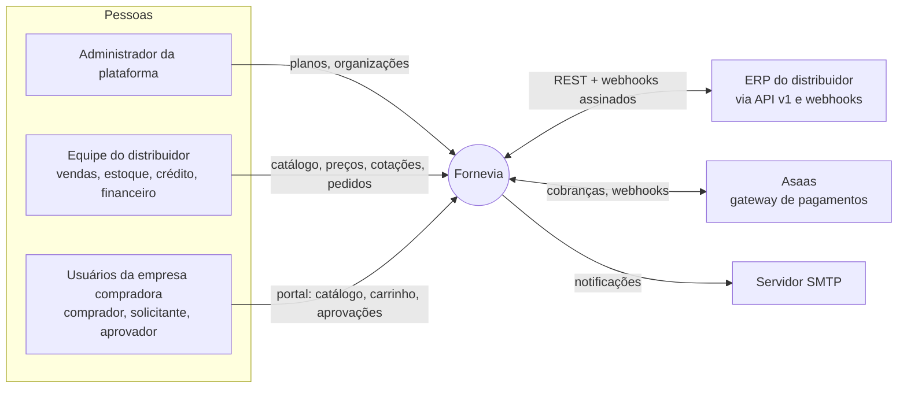
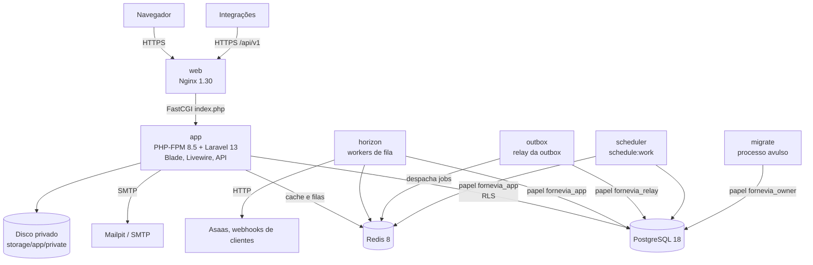
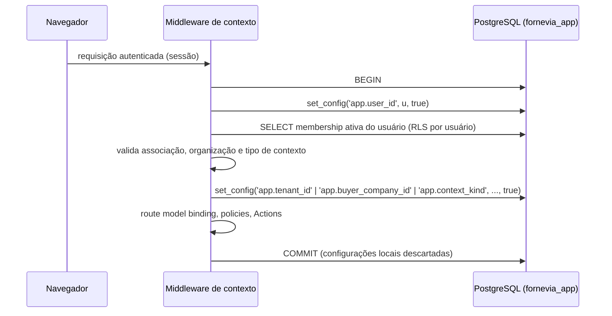

# Arquitetura

Visão técnica do Fornevia. Decisões e alternativas estão em
[DECISOES.md](DECISOES.md); requisitos em [REQUISITOS.md](REQUISITOS.md).

## 1. Contexto (C4 nível 1)

## 2. Containers (C4 nível 2)

| Container | Processo | Papel no banco |
|---|---|---|
| `web` | Nginx: arquivos estáticos e encaminhamento de `index.php` | — |
| `app` | PHP-FPM: interface Blade/Livewire e API v1 | `fornevia_app` |
| `horizon` | Workers Redis supervisionados | `fornevia_app` |
| `outbox` | `php artisan outbox:relay` | `fornevia_relay` |
| `scheduler` | `php artisan schedule:work` | `fornevia_app` |
| `migrate` | `php artisan migrate --force` (avulso) | `fornevia_owner` |

Migrations nunca rodam na inicialização de `app`, `horizon`, `scheduler`
ou `outbox`. O readiness (`/health/ready`) falha enquanto houver migration
pendente.

## 3. Organização do código

| Camada | Local | Responsabilidade |
|---|---|---|
| Domínio | `app/Domain/<Contexto>` | Regras puras e value objects (Money, Quantity, PriceResolver). Sem Laravel; testadas sem banco |
| Casos de uso | `app/Actions/<Contexto>` | Orquestram transação, locks, validações de negócio, ledger e outbox |
| Persistência | `app/Models/<Contexto>` | Eloquent com `BelongsToTenant`; sem regras de negócio extensas |
| Autorização | `app/Policies/<Contexto>` + Gates | Permissão do contexto e propriedade do objeto |
| HTTP | `app/Http` | Controllers finos, Form Requests, Resources da API v1 |
| Interface | `app/Livewire`, `resources/views` | Componentes que chamam Actions e Policies |
| Assíncrono | `app/Jobs` | Jobs idempotentes com identificadores (sem models serializados) |
| Integrações | `app/Integrations` | Adaptadores (pagamentos, webhooks) |
| Infraestrutura | `app/Support` | Tenancy, idempotência, outbox, observabilidade, HTTP |

## 4. Estratégia de multitenancy

- `CurrentContext` é *scoped*: descartado ao fim de cada requisição e antes
  de cada job pelo worker.
- `TenantDatabase::run()` é o único caminho para aplicar contexto. Aninhar
  o mesmo contexto reaproveita a transação; aninhar contexto diferente lança
  `TenantContextConflict`.
- Políticas de RLS: `tenant_isolation` (permissiva) em toda tabela com
  `tenant_id`; `buyer_isolation` (restritiva) em tabelas de comprador, que
  só exibem linhas da empresa do contexto quando o tipo é `buyer`.
- Funções: `app_current_tenant()`, `app_current_buyer()`,
  `app_current_user()`, `app_context_kind()`, `app_sees_all_buyers()`.

## 5. Papéis do banco

| Papel | Uso | Privilégios |
|---|---|---|
| `fornevia_owner` | migrations, manutenção | dono do schema; sujeito à RLS forçada |
| `fornevia_app` | aplicação, workers, scheduler | DML via default privileges; sem `UPDATE`/`DELETE` em ledgers; sem escrita em colunas de saldo |
| `fornevia_relay` | relay da outbox | apenas tabelas da outbox |

Provisionamento: `docker/postgres/init/01-roles.sh` (superusuário, uma vez
por cluster). Senhas por variáveis de ambiente.

## 6. Observabilidade

- Logs JSON em stderr (`LOG_STACK=json`), com `correlation_id`,
  `tenant_id`, `user_id` e `context_kind` vindos do `Context` do Laravel,
  propagados para jobs. Campos sensíveis são redigidos
  (`RedactSensitiveData`).
- `X-Request-Id` aceito em formato restrito ou gerado (UUIDv7).
- `/health/live` e `/health/ready` sem sessão nem cookies.
